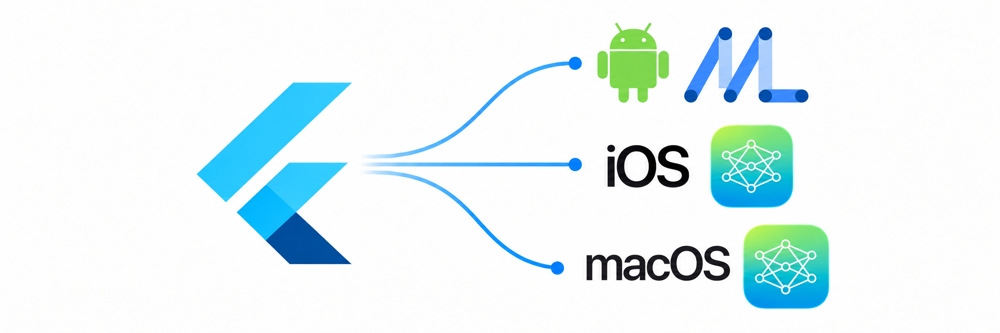

<p align="center">
  
</p>

# edge_gen_ai

A Flutter plugin for **on-device** generative AI. It uses Apple's Foundation
Models (iOS/macOS) and Google's Gemini Nano via ML Kit GenAI (Android) — no
network calls, no cloud API keys, no data leaving the device.

It uses the model the OS already ships with, so there's no model file to
manage; `downloadModel()` just triggers the OS's own on-demand delivery of
that shared system model when it isn't ready yet.

> [!IMPORTANT]
> **Platform versions matter a lot here:**
>
> - **iOS 26+** required, with Apple Intelligence enabled in Settings.
>   **iOS 27+** required for image input (Foundation Models `Attachment`, Beta).
> - **macOS 26+** required on an Apple Intelligence-capable Mac, with Apple
>   Intelligence enabled. **macOS 27+** required for image input (Beta).
> - **Android** API 26+ on a device with Gemini Nano/AICore support
>   (e.g. Pixel 8+, Samsung S23+). **Android's backend is Beta** —
>   ML Kit GenAI APIs have no SLA or backward-compatibility guarantee.
>   See [ML Kit GenAI](https://developers.google.com/ml-kit/genai).
>
> Use `checkAvailability()` to detect unsupported OS versions, disabled
> Apple Intelligence, or missing AICore support at runtime.

## Features

✅ Supported · 🟡 Beta / device-dependent · 🔜 Planned

| Feature | API | iOS | Android | macOS | Windows |
| :--- | :--- | :---: | :---: | :---: | :---: |
| Text generation | `EdgeGenAIPrompt.generateContent()` | ✅ | ✅ | ✅ | 🔜 |
| Streaming responses | `generateContent()` | ✅ | ✅ | ✅ | 🔜 |
| Image input | `generateContent(image: ...)` | 🟡 27+ | 🟡 Compatible devices | 🟡 27+ | 🔜 |
| Image description | `EdgeGenAIImageDescriber.describeImage()` | 🟡 27+ | 🟡 Gemini Nano | 🟡 27+ | 🔜 |
| Text summarization | `EdgeGenAISummarizer.summarize()` | ✅ | ✅ | ✅ | 🔜 |
| Proofreading | `EdgeGenAIProofreader.proofread()` | ✅ | ✅ | ✅ | 🔜 |
| Rewriting | `EdgeGenAIRewriter.rewrite()` | ✅ | ✅ | ✅ | 🔜 |
| Tool calling | `EdgeGenAITool` | ✅ Native | ✅ Structured output + text parsing | ✅ Native | 🔜 |
| Conversation memory | `EdgeGenAIPrompt(useMemory: true)` | ✅ | ✅ App-managed RAM | ✅ | 🔜 |
| Availability | `checkAvailability()` | ✅ | ✅ | ✅ | 🔜 |
| Model download | `downloadModel()` | ✅ None | ✅ Progress | ✅ None | 🔜 |

Android note: ML Kit does not provide native tool calling or conversation
memory. The plugin supports both: 🛠️ tool calls use structured output when
available, with text parsing and JSON validation as a fallback, then run the
Dart callback; 🧠 memory keeps recent messages and summaries in RAM per prompt
instance.

## Demo

| Class                     | Details                                                                            | Screenshot                                                                                            |
| ------------------------- | ---------------------------------------------------------------------------------- | ----------------------------------------------------------------------------------------------------- |
| `EdgeGenAIPrompt`         | Free-form prompt, streamed response, optional image input and conversation memory. |  |
| `EdgeGenAISummarizer`     | Summarizes text as bullet points.                                                  |  |
| `EdgeGenAIProofreader`    | Fixes grammar, spelling, and punctuation.                                          |  |
| `EdgeGenAIRewriter`       | Rewrites text in a chosen `EdgeGenAIRewriteStyle`.                                 |  |
| `EdgeGenAIImageDescriber` | Describes an image.                                                                |  |
| `EdgeGenAITool`           | Runs a Dart callback when the model requests one of your tools.                    |  |

## Usage

### Availability and downloads

```dart
final availability = await prompt.checkAvailability();

if (availability == EdgeGenAIAvailability.downloadable) {
  await for (final progress in prompt.downloadModel()) {
    print(progress.status);
  }
}
```

### Prompting

```dart
import 'package:edge_gen_ai/edge_gen_ai.dart';

final prompt = EdgeGenAIPrompt();

await for (final chunk in prompt.generateContent(
  'Write a 3 sentence story about a magical dog.',
)) {
  print(chunk);
}

await for (final chunk in prompt.generateContent(
  'What is in this picture?',
  image: imageBytes,
)) {
  print(chunk);
}
```

### Memory

```dart
final chat = EdgeGenAIPrompt(useMemory: true);
await for (final chunk in chat.generateContent('My name is Alex.')) {}
await for (final chunk in chat.generateContent('What is my name?')) {
  print(chunk); // remembers "Alex"
}
await chat.resetConversation(); // start fresh
```

### Stopping a response

```dart
await prompt.stop();
```

### Tool calling

```dart
final calculator = EdgeGenAITool(
  name: 'multiply_numbers',
  description: 'Multiplies two numbers.',
  parameters: [
    EdgeGenAIToolParameter(
      name: 'left',
      description: 'The first number.',
      type: EdgeGenAIToolParameterType.number,
    ),
    EdgeGenAIToolParameter(
      name: 'right',
      description: 'The second number.',
      type: EdgeGenAIToolParameterType.number,
    ),
  ],
  onCall: (arguments) async =>
      '${arguments['left'] * arguments['right']}',
);

final assistant = EdgeGenAIPrompt(tools: [calculator]);
await for (final response in assistant.generateContent(
  'Use the calculator to multiply 17 by 24.',
)) {
  print(response);
}
```

Use the task-specific features (each has its own `checkAvailability()` /
`downloadModel()`, exactly like `EdgeGenAIPrompt`):

```dart
final summary = await EdgeGenAISummarizer().summarize(longArticle);

final corrected = await EdgeGenAIProofreader().proofread('the quick brown fox jumsp');

final formal = await EdgeGenAIRewriter().rewrite(
  'hey, meeting is off',
  style: EdgeGenAIRewriteStyle.professional,
);

final description = await EdgeGenAIImageDescriber().describeImage(imageBytes);
```

See the [example app](example/lib/main.dart) for a chat UI and a text-tools
demo built on top of this API.

### Run on macOS

```sh
cd example
flutter run -d macos
```
